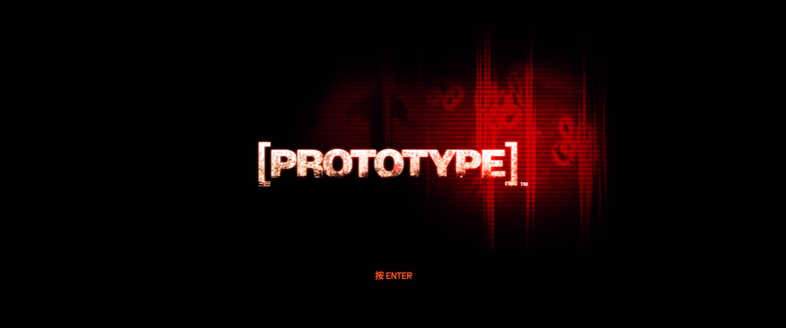

[中文](README.md) | [English](README_EN.md)

# Prototype (2009) Chinese Localization Patch

A Simplified Chinese localization patch for the PC version of **Prototype (2009)**, covering menus, missions, skills, story content, and in-game dialogue subtitles.

**Current version:** v0.2.13 · [Releases](https://github.com/OBLPlife/Prototype-Chinese/releases)

The installer reads the player's local game resources and generates a Chinese localization overlay.

## Screenshots

| | |
| :---: | :---: |
|  |  |
|  |  |

## Installation & Restoration

**Install**

1. Exit the game. The English-language game resources are recommended.
2. Download `Prototype_ZH_CN_Setup.exe` from [Releases](https://github.com/OBLPlife/Prototype-Chinese/releases).
3. Place the installer in the game directory, alongside `cementfiles.p3d`.
4. Run the installer and select **安装** (Install). Python is bundled with the installer and does not need to be installed separately.
5. Launch the game normally after installation.

**Restore**

Exit the game, run the same installer in the game directory, and select **还原** (Restore).

The installer backs up affected files and restores their previous contents when requested. Keep the `PrototypeZh` backup directory intact. Changes made to the same files by other patches after this installation are preserved during restoration.

Allow approximately **1.2 GiB** of free space on the game drive for the generated localization resources during the first installation. Additional space may be required to back up existing files.

## Localization Features

- **18,402 main text records:** 3,127 UI entries, 957 story subtitle entries, and 14,318 audio-embedded dialogue subtitle entries.
- **Menus and missions:** Settings, controls, objectives, skill names, upgrades, and Web of Intrigue text.
- **Dialogue and subtitles:** Story, combat, and character dialogue, including subtitles embedded in the original audio resources.
- **Chinese fonts:** Full GBK character coverage with separate Noto Sans CJK font weights for titles, menus, and subtitles.
- **Text layout:** Adjustments to upgrade menu labels, Evolution Points display, and selected subtitle layouts.
- **Consistent terminology:** Localized in-universe organizations, abilities, and project names while preserving personal names in credits and real-world company names.
- **Original visuals:** Street signs, advertisements, posters, and other environmental textures remain unchanged.

The localization can be installed independently. It also includes translations for display-mode options used by the modern compatibility patch.

## Installation Compatibility

The installer includes translations, required fonts, UI adjustments, and a localization runtime. It reconstructs the Chinese overlay from the player's existing game files.

It validates relevant resources and engine interfaces instead of requiring a whole-game file hash match. If the required resources differ, the installer asks for confirmation and preserves content it cannot safely match; some text may therefore remain untranslated.

## Building from Source

This repository includes translation catalogs, a C++ localization runtime, ActionScript UI sources, a C# installer, and Python resource-building utilities. Building requires English-language game resources, external tools, and font files.

Key dependencies include Windows x64, Python 3.13, fontTools, JDK, FFDec 26.4.0, MSVC x86, Windows SDK, the .NET Framework 4.x C# compiler, Noto fonts, and the official Python 3.13.12 embeddable runtime. Font sources and hashes are documented in [catalog/font-sources.json](catalog/font-sources.json).

The build scripts expect a workspace containing `source/PrototypeZh/`, `vendor/`, and `work/` directories. See the [source build guide](packaging/SOURCE.md) for the build procedure and the [packaging guide](packaging/README.md) for the installer.

### Repository Layout

| Path | Contents |
| --- | --- |
| `catalog/` | UI, story, audio subtitle, and terminology translations |
| `runtime/` | C++ font, subtitle, and runtime support |
| `src/` | ActionScript UI text sources |
| `tools/` | Resource extraction, font generation, translation merging, and checks |
| `packaging/` | Installer, build, and restoration code |
| `licenses/` | Third-party Noto font licenses |
| `screenshots/` | In-game screenshots |

## Important Notice

**This is a preview release. Unknown issues may still exist.**

